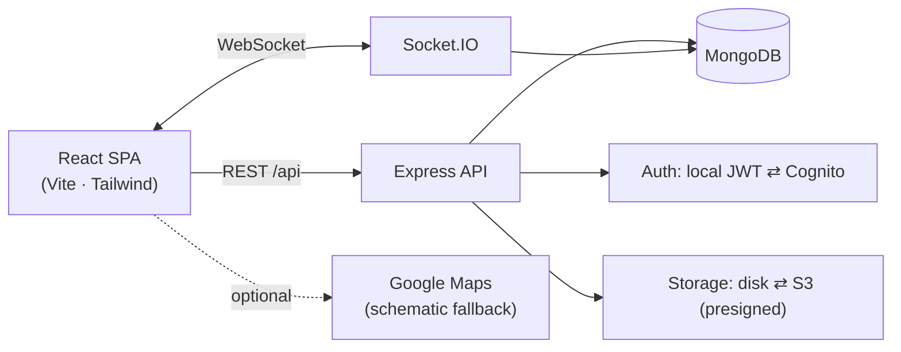

# 🎓 CampusOne

**A unified, cloud-ready platform for student productivity and campus collaboration.**

CampusOne brings everything a college needs into one place: a virtual campus map
and faculty finder, an academic resource library (PYQs, assignments, guides, lab
manuals, study material), notices and events, a moderated student community with
**real-time chat**, personalized recommendations, global search, bookmarks, and a
full admin panel — built as a real, working full-stack application.

> Built for the MIT School of Computing PBL. Designed to run **fully locally with
> zero cloud accounts**, and to scale onto AWS (Cognito + S3 + Elastic Beanstalk +
> CloudFront) by flipping environment variables — **no code changes**.

---

## Table of contents
- [Features](#-features)
- [Tech stack](#-tech-stack)
- [Architecture](#-architecture)
- [Project structure](#-project-structure)
- [Quick start (local, no cloud)](#-quick-start-local-no-cloud)
- [Run with Docker](#-run-with-docker)
- [Environment variables](#-environment-variables)
- [Demo accounts](#-demo-accounts)
- [Testing](#-testing)
- [API reference](#-api-reference)
- [Deploying to AWS](#-deploying-to-aws)
- [Features that need external keys](#-features-that-need-external-keys)
- [Limitations & future work](#-limitations--future-work)

---

## ✨ Features

**All users**
- 🔐 Register / login with JWT (access + refresh) and role-based access control
- 🏠 Role-aware dashboard with quick links, notices, events and stats
- 🗺️ **Virtual campus map** — interactive schematic that works with *no* map key; "Open in Google Maps" when coordinates exist
- 🧭 **Faculty finder** — search by name/department, cabin number, availability, subjects, and "locate on map"
- 📚 **Academic resources** — browse/upload PYQs, assignments, assignment guides, lab manuals & study materials; download, bookmark, filter & sort
- 💬 **Community** — posts, comments, likes, tags, categories, reporting
- ⚡ **Real-time chat** — direct & group rooms, presence, typing indicators, unread badges (Socket.IO)
- 🔔 Notifications, 🔖 bookmarks, 🔎 global search, 🤖 personalized recommendations
- 👤 Editable profile + password change

**Faculty**
- Post & manage notices (with attachments) and events; upload resources (auto-approved)

**Admin**
- 📊 Platform stats dashboard
- 👥 User management (create/edit/disable/delete, role changes with self-lockout guards)
- ✅ Resource approval queue (approve / reject with reason)
- 🛡️ Community moderation (hide/unhide posts, dismiss reports, delete)
- 📍 Campus location management (map pins CRUD)

Every data view has proper **loading, empty and error states**, optimistic UI for
likes/RSVP/bookmarks, and toast notifications.

---

## 🧰 Tech stack

| Layer | Technology |
|---|---|
| Frontend | React 18, Vite, React Router v6, Tailwind CSS, Axios, Socket.IO client, lucide-react, react-hot-toast |
| Backend | Node.js, Express, Socket.IO, Mongoose, express-validator, JWT (jsonwebtoken) / Cognito (jwks-rsa), bcryptjs, helmet, cors, compression, express-rate-limit, multer |
| Database | MongoDB (local, Docker, or MongoDB Atlas) |
| Cloud (optional) | AWS Cognito (auth), Amazon S3 (files, private + presigned URLs), Elastic Beanstalk/EC2, CloudFront |
| DevOps | Docker, docker-compose, GitHub Actions CI, ESLint, Vitest |

**Design principles**: pluggable **auth provider** (`local` ⇄ `cognito`) and
**storage driver** (`local` ⇄ `s3`) selected by env var; one consistent response
envelope; secrets only ever in `.env`; large files never stored in MongoDB.

---

## 🏗️ Architecture



Full diagrams (request lifecycle, real-time flow, data model, AWS topology) are in
[`docs/architecture/README.md`](docs/architecture/README.md).

---

## 📁 Project structure

```
CampusOne/
├── backend/                  # Node + Express + Socket.IO REST API
│   ├── src/
│   │   ├── config/           # env, db, provider resolution
│   │   ├── controllers/      # route handlers (auth, resources, community, admin, …)
│   │   ├── middleware/       # auth (JWT/Cognito), authorize (RBAC), validate, errors
│   │   ├── models/           # Mongoose schemas (User, Resource, CampusLocation, …)
│   │   ├── routes/           # /api/* routers
│   │   ├── services/         # authService, storageService (disk/S3), recommendation
│   │   ├── sockets/          # chatSocket (chat, presence, notifications)
│   │   ├── seed/             # seed.js — demo data + downloadable placeholder files
│   │   ├── utils/            # apiResponse, ApiError, constants, logger
│   │   ├── app.js            # Express app (testable, no listen)
│   │   └── server.js         # HTTP + Socket.IO bootstrap
│   ├── tests/                # Vitest + Supertest (auth, RBAC, resources, community)
│   ├── Dockerfile · .dockerignore · .env.example · eslint.config.js
│
├── frontend/                 # React + Vite SPA
│   ├── src/
│   │   ├── components/        # ui/ layout/ admin/ community/ resources/ notices/ events/
│   │   ├── context/           # AuthContext, NotificationContext
│   │   ├── hooks/             # useApi, useDebounce
│   │   ├── pages/             # 25+ pages (dashboard, map, resources, community, admin/…)
│   │   ├── services/          # api (Axios + refresh), socket (Socket.IO)
│   │   ├── utils/             # constants, format, cn
│   │   ├── App.jsx · main.jsx · index.css
│   ├── public/favicon.svg
│   ├── Dockerfile · nginx.conf · .dockerignore · .env.example · eslint.config.js
│
├── docs/
│   ├── architecture/README.md   # diagrams & design
│   └── api/README.md            # endpoint reference
├── .github/workflows/ci.yml     # lint + test + build + docker
├── docker-compose.yml           # mongo + backend + frontend
└── README.md
```

---

## 🚀 Quick start (local, no cloud)

**Prerequisites:** Node.js ≥ 18, npm, and MongoDB running locally
(`mongodb://127.0.0.1:27017`) — or a free MongoDB Atlas URI. No AWS account needed.

### 1) Backend

```bash
cd backend
cp .env.example .env          # defaults work out of the box (local auth + disk storage)
npm install
npm run seed                  # loads demo departments, users, resources, notices, events…
npm run dev                   # API on http://localhost:5000  (health: /api/health)
```

### 2) Frontend (in a second terminal)

```bash
cd frontend
cp .env.example .env          # leave values blank in dev — Vite proxies to the backend
npm install
npm run dev                   # SPA on http://localhost:5173
```

Open **http://localhost:5173** and log in with a [demo account](#-demo-accounts).

> On Windows without a local Mongo install, the easiest path is a free Atlas
> cluster: set `MONGODB_URI=mongodb+srv://…` in `backend/.env`, then `npm run seed`.

---

## 🐳 Run with Docker

Runs the whole stack (MongoDB + API + nginx-served SPA) with demo data seeded
automatically. Requires Docker Desktop.

```bash
docker compose up --build
```

- App: **http://localhost:8080**
- API: **http://localhost:5000/api/health**

nginx proxies `/api` and `/socket.io` to the backend, so the browser uses a single
origin (no CORS). Override the JWT secrets for anything non-throwaway:

```bash
JWT_SECRET=$(openssl rand -hex 32) JWT_REFRESH_SECRET=$(openssl rand -hex 32) docker compose up --build
```

---

## 🔑 Environment variables

Secrets are **never** hard-coded. Copy the example files and fill in real values;
`.env` files are git-ignored. See [`backend/.env.example`](backend/.env.example) and
[`frontend/.env.example`](frontend/.env.example) for the annotated full list.

**Backend (essentials)**

| Variable | Default | Purpose |
|---|---|---|
| `MONGODB_URI` | `mongodb://127.0.0.1:27017/campusone` | Database connection |
| `PORT` | `5000` | API port |
| `CLIENT_URL` | `http://localhost:5173` | Allowed CORS origin(s), comma-separated |
| `AUTH_PROVIDER` | `local` | `local` (JWT here) or `cognito` |
| `JWT_SECRET` / `JWT_REFRESH_SECRET` | — | Signing secrets (local auth) |
| `STORAGE_DRIVER` | `local` | `local` (disk) or `s3` |
| `S3_BUCKET`, `AWS_REGION`, `AWS_ACCESS_KEY_ID`, `AWS_SECRET_ACCESS_KEY` | — | S3 storage |
| `COGNITO_USER_POOL_ID`, `COGNITO_CLIENT_ID` | — | Cognito auth |
| `SEED_ON_START` | `false` | Seed demo data on boot (used by Docker) |

**Frontend** (only `VITE_*` values are exposed to the browser — never put secrets here)

| Variable | Dev | Purpose |
|---|---|---|
| `VITE_API_URL` | blank (proxy) | API base URL incl. `/api` in production |
| `VITE_SOCKET_URL` | blank (same origin) | Socket.IO origin in production |
| `VITE_GOOGLE_MAPS_API_KEY` | optional | Not required — map has a schematic fallback |

---

## 👤 Demo accounts

Created by `npm run seed` (and auto-seeded in Docker). **Sample data — not real people.**

| Role | Email | Password |
|---|---|---|
| Admin | `admin@campusone.edu` | `Admin@123` |
| Faculty | `prof.sharma@campusone.edu` | `Faculty@123` |
| Student | `aarav@campusone.edu` | `Student@123` |

More students: `diya@`, `kabir@`, `sara@` `@campusone.edu` — all `Student@123`.

---

## 🧪 Testing

**Backend** — Vitest + Supertest against an in-memory MongoDB (no real DB needed).
Covers auth, RBAC/authorization, resource CRUD + upload, and community flows.

```bash
cd backend && npm test
```

**Frontend** — Vitest unit tests for shared utilities.

```bash
cd frontend && npm test
```

Lint both projects with `npm run lint`. CI (GitHub Actions) runs lint + tests +
frontend build + Docker image builds on every push/PR — see
[`.github/workflows/ci.yml`](.github/workflows/ci.yml).

---

## 📖 API reference

Full endpoint list with access levels and payloads:
[`docs/api/README.md`](docs/api/README.md). Quick check: `GET /api/health`.

---

## ☁️ Deploying to AWS

The app is built to move to AWS by configuration alone. Reference topology
(diagram in [docs/architecture](docs/architecture/README.md#8-deployment-topology-aws-reference)):

**1. Database — MongoDB Atlas**
- Create a cluster, add a DB user, allow-list your server IPs.
- Set `MONGODB_URI=mongodb+srv://…` on the backend.

**2. Auth — Amazon Cognito** *(optional; default is local JWT)*
- Create a User Pool + App Client.
- Set `AUTH_PROVIDER=cognito`, `COGNITO_USER_POOL_ID`, `COGNITO_CLIENT_ID`, `AWS_REGION`.
- The API verifies Cognito JWTs via the pool's JWKS; user profiles are mirrored in MongoDB.

**3. File storage — Amazon S3** *(optional; default is local disk)*
- Create a **private** bucket (no public access).
- Set `STORAGE_DRIVER=s3`, `S3_BUCKET`, `AWS_REGION`, and credentials (prefer an IAM role on EC2/EB over static keys).
- Downloads are served via short-lived **presigned URLs**, so the bucket stays private.

**4. API — Elastic Beanstalk (Node) or EC2**
- Deploy `backend/` (or the Docker image). Set all env vars in the EB/EC2 environment.
- Behind an Application Load Balancer, enable **sticky sessions** for Socket.IO.
- Set `CLIENT_URL` to your CloudFront/frontend domain.

**5. Frontend — S3 + CloudFront**
- `cd frontend && VITE_API_URL=https://api.yourdomain.com/api VITE_SOCKET_URL=https://api.yourdomain.com npm run build`
- Upload `dist/` to an S3 bucket configured for static hosting; front it with CloudFront (HTTPS + SPA error routing to `index.html`).

> Tip: `GET /api/health` reports the active `authProvider` and `storageDriver`, so
> you can confirm a deployment picked up the right providers.

---

## 🔌 Features that need external keys

Everything works locally with **no keys**. The following are *optional* upgrades:

| Feature | Without a key | With the key |
|---|---|---|
| Campus map | Fully interactive **schematic** map (percent-based pins) | Adds real geo "Open in Google Maps" links; a Maps JS key can power an embedded map |
| Auth | Local JWT + bcrypt | AWS Cognito hosted auth |
| File storage | Files on local disk, served via `/api/files` | Private S3 bucket + presigned download URLs |
| AI recommendations | Rule-based engine (subjects, semester, popularity) | Swap in an LLM by replacing the recommendation service (interface unchanged) |

---

## 🚧 Limitations & future work

- **Recommendations are rule-based (v1).** Deterministic and explainable; the
  service is isolated behind a stable interface so an LLM-backed version can be
  dropped in without touching callers.
- **Campus map is a schematic**, not a real geospatial map, unless a Maps key and
  `geo` coordinates are supplied. This is intentional so the project runs key-free.
- **Local storage is single-node.** For multi-instance / production use S3
  (`STORAGE_DRIVER=s3`); local disk won't be shared across instances.
- **Socket.IO scaling** across multiple API instances would need a Redis adapter
  (single instance works as-is).
- **Cognito path** mirrors users into MongoDB for RBAC/profile; advanced flows
  (MFA, social login, hosted UI theming) are configured in Cognito, not here.
- **Email/SMS notifications** are in-app only; outbound email (e.g. SES) is not wired.
- **Test coverage** focuses on critical backend paths (auth, RBAC, resources,
  community) and frontend utilities — not full end-to-end UI coverage.
- **Rate limits / file-size caps** use sensible defaults; tune for production load.

---

<p align="center"><sub>CampusOne — built with React, Node.js, Express, MongoDB and Socket.IO. Sample data is fictional.</sub></p>
