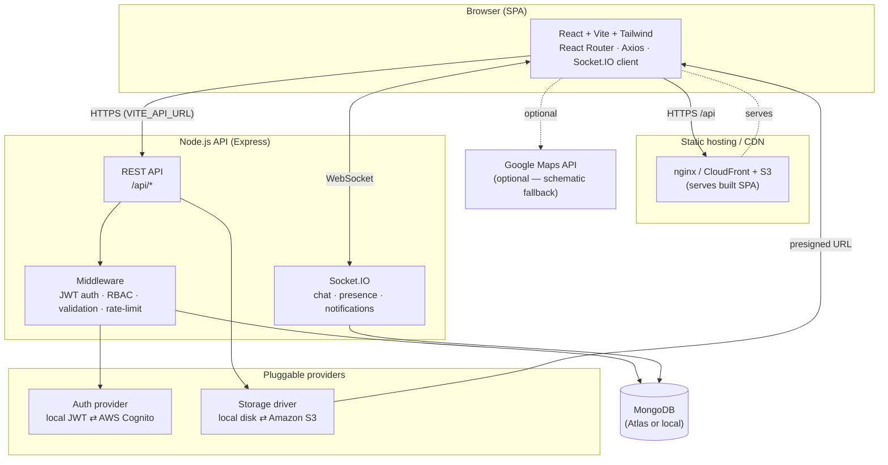
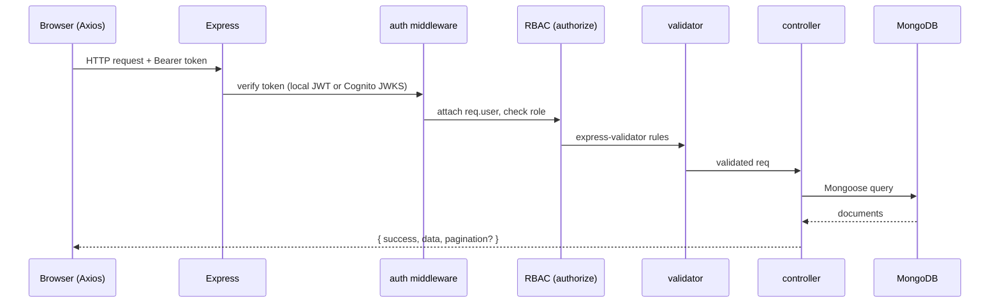
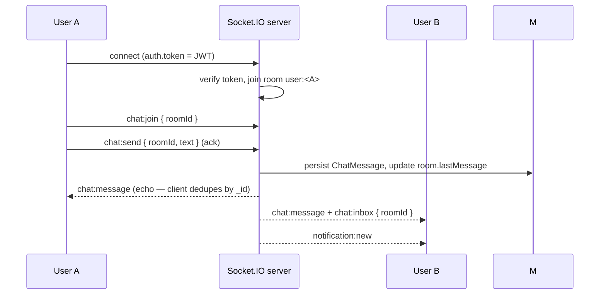
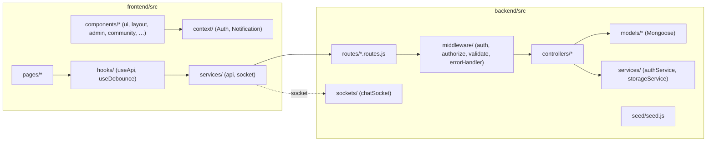
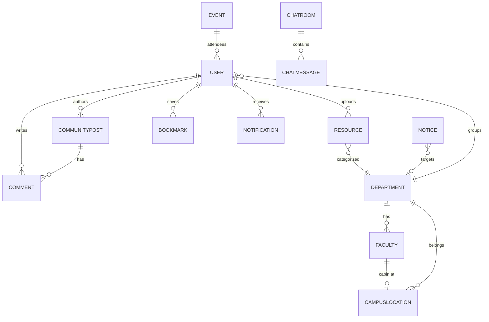
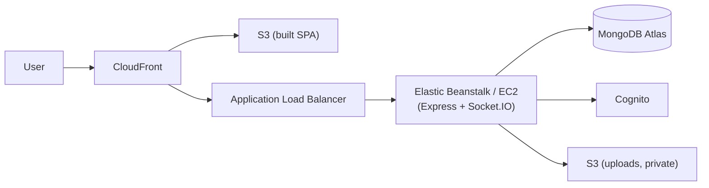

# CampusOne — Architecture

CampusOne is a unified, cloud-ready platform for a college campus: virtual map &
faculty finder, academic resources, notices, events, a student community with
live chat, notifications, bookmarks, recommendations and an admin panel.

This document explains **how the pieces fit together**. For the endpoint-by-endpoint
reference see [`../api/README.md`](../api/README.md). For setup and deployment see the
[root README](../../README.md).

---

## 1. High-level system diagram



The two provider boxes are the heart of the design: **auth** and **file storage**
are abstractions selected by environment variable, so the exact same code runs
with zero cloud accounts (local JWT + disk) or fully on AWS (Cognito + S3) with
no source changes.

---

## 2. Request lifecycle (REST)



Every response uses one envelope:

```jsonc
// success
{ "success": true, "data": { /* ... */ }, "message": "optional" }
// list
{ "success": true, "data": [ /* ... */ ],
  "pagination": { "page": 1, "limit": 20, "total": 57, "totalPages": 3, "hasMore": true } }
// error (from the centralized error handler)
{ "success": false, "message": "Human readable error" }
```

On a `401`, the Axios interceptor transparently calls `/api/auth/refresh` once,
retries the original request, and on failure clears the session and emits an
`auth:logout` event the app listens for.

---

## 3. Real-time layer (Socket.IO)



- Handshake auth uses the same JWT as REST (`auth.token`).
- Each socket joins `user:<id>` (for direct notifications) and `room:<roomId>`
  channels on demand.
- The server **echoes** `chat:message` to the sender too, so the client
  de-duplicates by message `_id` and has a single append path. If the socket
  send times out, the client falls back to the REST endpoint.
- Presence (`presence:update`) and typing (`chat:typing`) are broadcast to room
  members.

---

## 4. Component / module map



---

## 5. Data model (core collections)



Key notes:
- **Resource** is a single collection with a `type` enum (`pyq`, `assignment`,
  `assignment_guide`, `lab_manual`, `study_material`) rather than five tables —
  simpler queries and one moderation flow. Large files are **never** stored in
  MongoDB; only file metadata (`{ key, url, driver, mimeType, size }`) is kept,
  the bytes live on disk or S3.
- **CampusLocation** stores `coords {x,y}` as percentages so the interactive map
  works with no map provider; optional `geo {lat,lng}` enables "Open in Google
  Maps".
- **CommunityPost** embeds `likes[]` and `reports[]` for O(1) "liked by me" and
  moderation without extra collections.

---

## 6. Pluggable providers

### Auth (`AUTH_PROVIDER`)
| Value | Behaviour |
|-------|-----------|
| `local` (default) | Passwords hashed with bcrypt; server issues short-lived access + long-lived refresh JWTs. |
| `cognito` | Verifies AWS Cognito JWTs against the pool's JWKS; user records are still mirrored in MongoDB for profile data and RBAC. |

### Storage (`STORAGE_DRIVER`)
| Value | Behaviour |
|-------|-----------|
| `local` (default) | Files saved under `UPLOAD_DIR`, served via `/api/files/*`. |
| `s3` | Objects uploaded to a **private** S3 bucket; downloads use short-lived **presigned URLs** so the bucket is never public. Falls back to `local` automatically if S3 isn't fully configured. |

Both are resolved once at startup and surfaced on `GET /api/health`
(`authProvider`, `storageDriver`) for quick diagnostics.

---

## 7. Security model

- **Authentication** — JWT (local) or Cognito JWTs; refresh-token rotation on the client.
- **Authorization (RBAC)** — three roles (`student`, `faculty`, `admin`); route
  guards (`authenticate`, `authorize`, `adminOnly`) enforce access; ownership
  checks on mutate/delete.
- **Input validation** — `express-validator` on every write route.
- **Transport / headers** — `helmet`, CORS restricted to `CLIENT_URL`, `compression`.
- **Abuse** — `express-rate-limit` (global + stricter on `/api/auth`).
- **Secrets** — never hard-coded; all via `.env` (see the two `.env.example` files).
  No secret is exposed to the browser (only `VITE_*` values ship to the client).

---

## 8. Deployment topology (AWS reference)



The SPA is static (S3 + CloudFront); the API runs on Elastic Beanstalk or EC2
behind an ALB (sticky sessions enabled for WebSockets). MongoDB Atlas, Cognito
and the private uploads bucket are managed services. Locally the same three tiers
run via `docker compose` (MongoDB + backend + nginx-served frontend).
